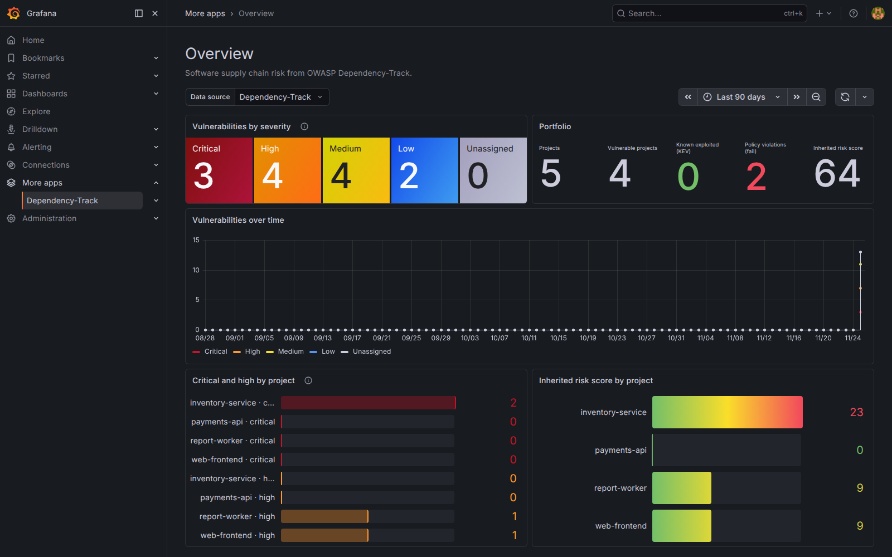
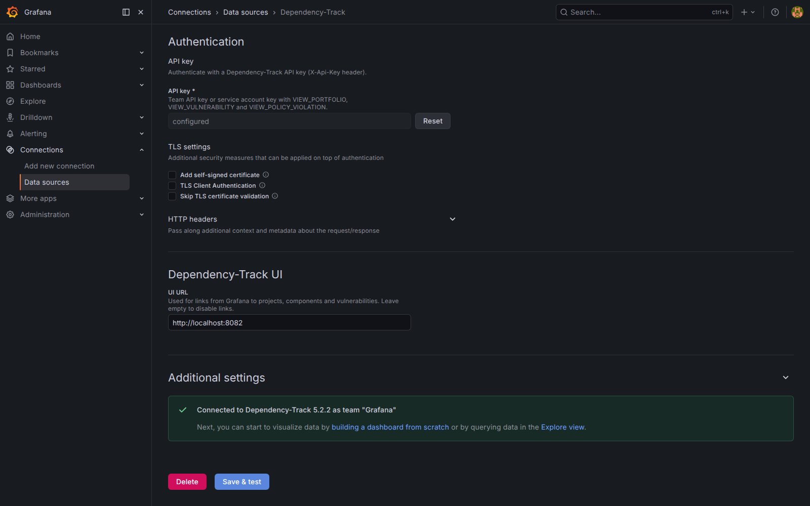
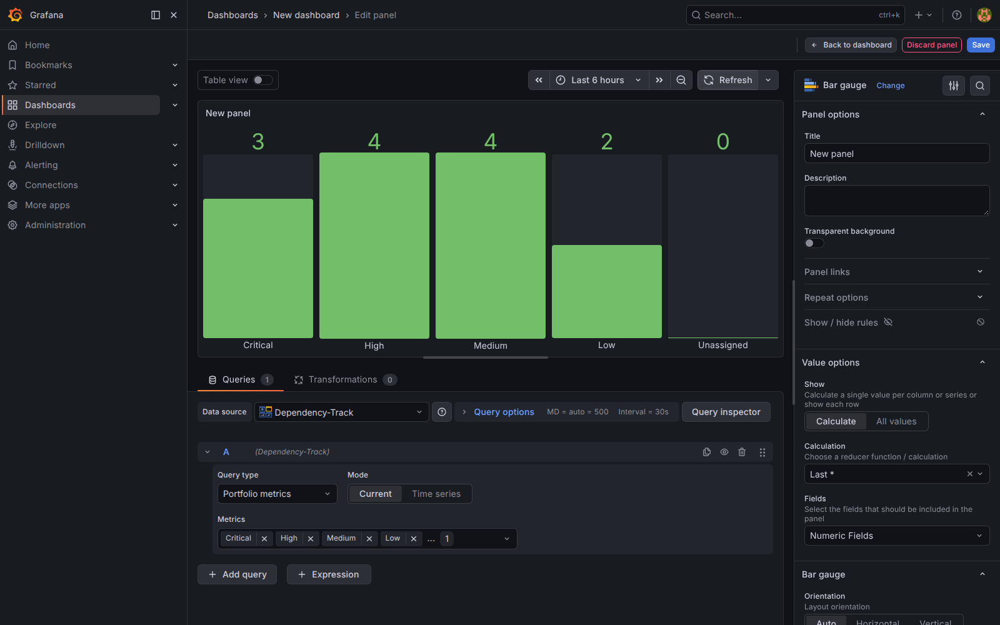
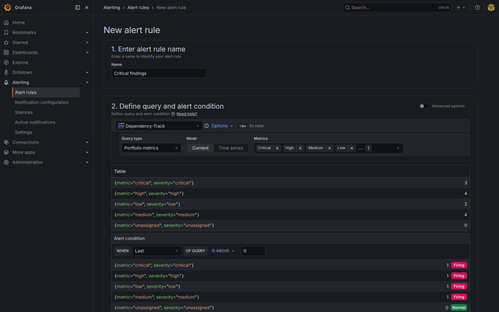
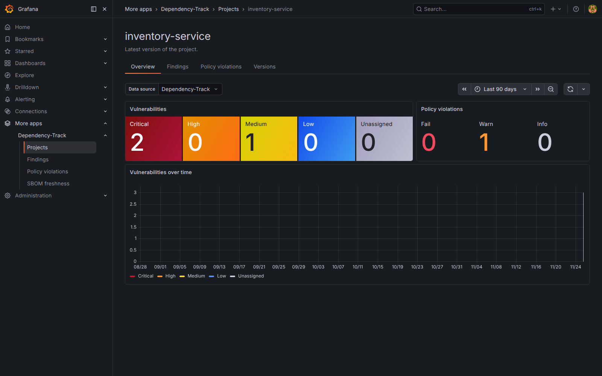
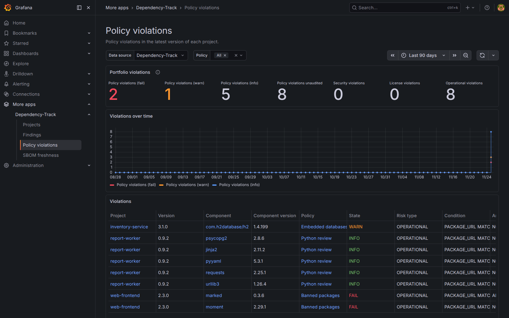
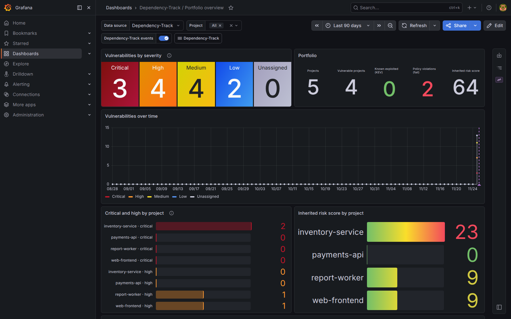
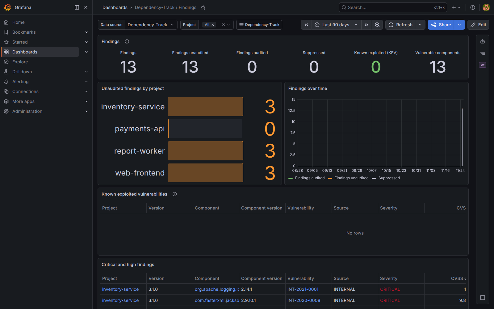
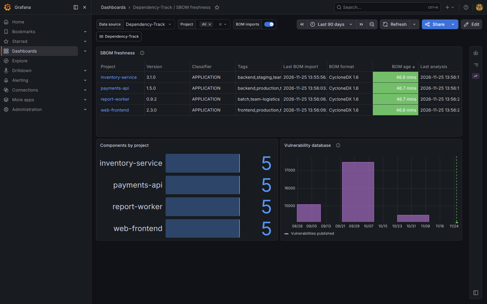

# Dependency-Track for Grafana

[](https://github.com/WindKube/grafana-plugin-dependency-track/actions/workflows/ci.yml)
[](https://github.com/WindKube/grafana-plugin-dependency-track/blob/main/LICENSE)

Visualize and alert on your software supply chain risk from [OWASP Dependency-Track](https://dependencytrack.org/): vulnerabilities, policy violations and SBOM freshness across your portfolio, next to the rest of your observability data.



## Features

- **App pages** built with Grafana Scenes: portfolio overview, projects with a per-project drill-down, findings, policy violations and SBOM freshness.
- **Five bundled dashboards** that you can copy and adapt.
- **A backend data source** for portfolio and project metrics, findings, policy violations, project inventory and the vulnerability database.
- **Alerting.** Every numeric query returns one series per project, labelled with `project`, `version` and `tags`, so a single rule alerts per project.
- **Annotations** for BOM imports, new findings and policy violations.
- **Template variables** for projects, versions, tags, classifiers and policies.
- **Links into Dependency-Track** from projects, components and vulnerabilities in tables.
- **Gentle on Dependency-Track.** Responses are cached and requests are capped per data source, and every list is fully paginated. The plugin only reads data and never triggers a metrics refresh.

## Requirements

- Grafana 13.0 or later
- Dependency-Track 5.x
- A Dependency-Track API key with these permissions:
  - `VIEW_PORTFOLIO`
  - `VIEW_VULNERABILITY`
  - `VIEW_POLICY_VIOLATION`

  The key can belong to a team or a service account.

## Configuration

1. Install the plugin and enable the **Dependency-Track** app under **Administration → Plugins and data → Plugins**.
2. Add a **Dependency-Track** data source under **Connections → Data sources**.
3. Fill in:

   | Setting                  | Description                                                                                   |
   | ------------------------ | --------------------------------------------------------------------------------------------- |
   | Dependency-Track API URL | API server URL, for example `https://dtrack-api.example.com`                                  |
   | API key                  | Stored encrypted in Grafana and sent as the `X-Api-Key` header                                |
   | UI URL                   | Dependency-Track frontend URL, used for links from tables. Leave empty to disable links.      |
   | Cache TTL                | Seconds to reuse responses across panels, alerts and users (default 60, `0` disables caching) |
   | Max concurrent requests  | Upper bound on simultaneous requests to Dependency-Track (default 10)                         |

4. Click **Save & test**. The health check reports the Dependency-Track version and the team that the key belongs to.



## Query types

| Query type             | Returns                                                                                                          |
| ---------------------- | ---------------------------------------------------------------------------------------------------------------- |
| Portfolio metrics      | Portfolio-wide counts by severity, findings, policy violations and risk score, as current values or time series  |
| Project metrics        | The same metrics for each selected project                                                                       |
| Findings               | One row per finding, or per-project counts for alerting. Filter by severity, analysis state, CVSS, EPSS and KEV. |
| Policy violations      | One row per violation, or counts per project or per policy. Filter by state, risk type and policy.               |
| Projects               | Project inventory with last BOM import and risk details, or the BOM age in seconds for alerting                  |
| Vulnerability database | Vulnerabilities published per month, from the Dependency-Track vulnerability database                            |
| Events                 | BOM imports, new findings and policy violations, for annotations                                                 |

Projects can be selected as all projects, by name regex, tag, classifier, or picked one by one. By default only the latest version of each project is included.



## Alerting

Metric, count and BOM age queries return one numeric value per project, labelled with `project`, `version` and `tags`. Use them in Grafana-managed alert rules with a **Reduce** and **Threshold** expression:

| Alert on                        | Query                                                          | Condition               |
| ------------------------------- | -------------------------------------------------------------- | ----------------------- |
| Critical vulnerabilities        | Project metrics, Current, metric `Critical`                    | above 0                 |
| Known exploited vulnerabilities | Portfolio metrics, Current, metric `Known exploited (KEV)`     | above 0                 |
| Failing policies                | Policy violations, format Count, state `FAIL`, Group by policy | above 0                 |
| Stale SBOMs                     | Projects, format BOM age                                       | above 2592000 (30 days) |

Projects that never received an SBOM report an infinite BOM age, so stale-SBOM rules fire for them too.

Ready-to-use rules in Grafana provisioning format are in [`examples/alerting`](https://github.com/WindKube/grafana-plugin-dependency-track/tree/main/examples/alerting).



## App pages

The app adds a **Dependency-Track** section to the Grafana navigation:

- **Overview:** vulnerabilities by severity, portfolio totals, history and the riskiest projects.
- **Projects:** every project with its risk. Open a project for its own overview, findings, policy violations and versions.
- **Findings:** critical and high findings, known exploited vulnerabilities and unaudited findings by project.
- **Policy violations:** violations by policy and project, filterable by policy.
- **SBOM freshness:** time since the last BOM import per project. Projects without an SBOM are listed as never imported.





## Dashboards

The app bundles five dashboards, imported when you enable the app. They use a data source variable, so they work with any Dependency-Track data source.

| Dashboard          | Shows                                                                     |
| ------------------ | ------------------------------------------------------------------------- |
| Portfolio overview | Severity totals, history, riskiest projects and Dependency-Track events   |
| Project            | One project: metrics, history, findings and policy violations             |
| Findings           | Audit status, known exploited vulnerabilities, critical and high findings |
| Policy violations  | Violations by policy, state and project                                   |
| SBOM freshness     | BOM age per project, color-coded at 7 and 30 days                         |







## Provisioning

```yaml
apiVersion: 1

datasources:
  - name: Dependency-Track
    uid: dependencytrack
    type: windkube-dependencytrack-datasource
    access: proxy
    url: https://dtrack-api.example.com
    jsonData:
      uiUrl: https://dtrack.example.com
    secureJsonData:
      apiKey: $DEPENDENCY_TRACK_API_KEY
```

To enable the app through provisioning, add a file under `provisioning/plugins`:

```yaml
apiVersion: 1

apps:
  - type: windkube-dependencytrack-app
    org_id: 1
```

## Terraform

[`examples/terraform`](https://github.com/WindKube/grafana-plugin-dependency-track/tree/main/examples/terraform) uses the [Grafana provider](https://registry.terraform.io/providers/grafana/grafana/latest) to create the data source, a folder, and alert rules for critical vulnerabilities and stale SBOMs:

```hcl
resource "grafana_data_source" "dependency_track" {
  type = "windkube-dependencytrack-datasource"
  name = "Dependency-Track"
  url  = var.dependency_track_url

  json_data_encoded = jsonencode({
    uiUrl = var.dependency_track_ui_url
  })
  secure_json_data_encoded = jsonencode({
    apiKey = var.dependency_track_api_key
  })
}
```

## Contributing

See [CONTRIBUTING.md](https://github.com/WindKube/grafana-plugin-dependency-track/blob/main/CONTRIBUTING.md).

## License

[Apache License 2.0](https://github.com/WindKube/grafana-plugin-dependency-track/blob/main/LICENSE)
